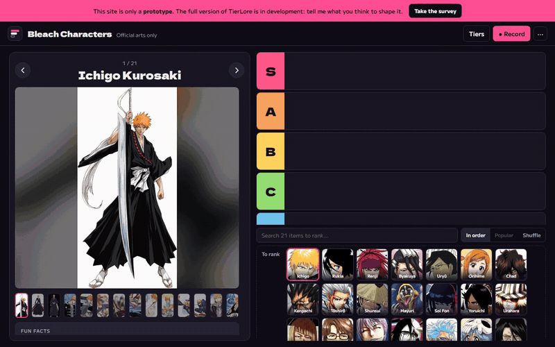
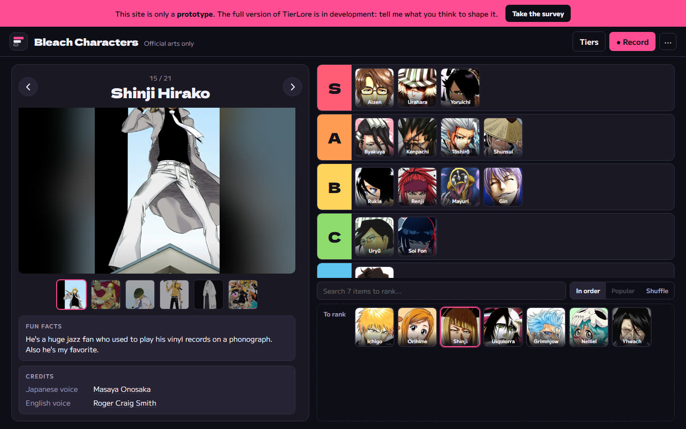
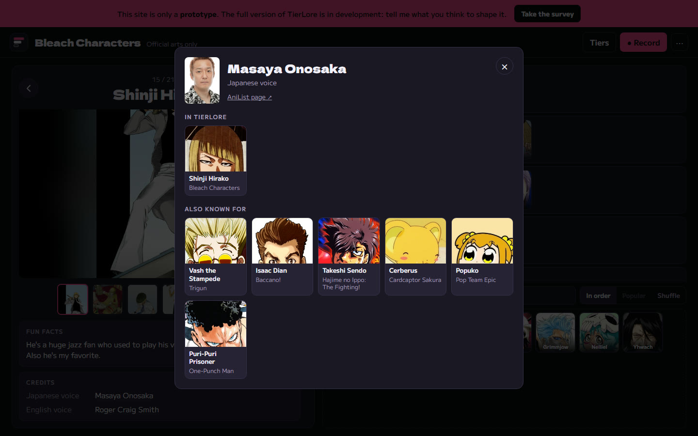
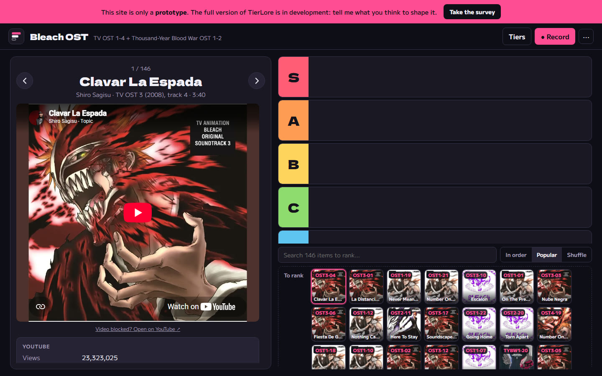

# TierLore

A tier list site for anime, where each thing you rank comes with its context: official art for the
characters, fun facts and voice actors, the video for each opening, ending and soundtrack.

I made it as a tool for reaction videos. Ranking Bleach characters or openings in a video works better
when the picture, the fun fact or the song is right there next to the board, instead of in another tab.
This is the prototype: a full version of TierLore is in development, and the banner on the site links to a
survey about it.

**Try it here: https://tierlore.com**



## What it does

Open a list and the first item shows on the left. Click a tier letter to put it there and the next one
to rank opens, or drag the cards around the board. The ranking is saved in the browser, so you can close
the tab and come back to it.



- The lists on the site: Bleach characters, openings, endings and soundtrack (146 tracks), Demon Slayer
  characters and openings.
- Character sheets have several official pictures, a fun fact and the Japanese and English voice actors.
- Songs play in an embedded YouTube player and show their view count. **Popular** sorts a list by views,
  **Shuffle** mixes it.
- A voice actor or a singer is clickable: their card lists everything they're credited on across the
  lists, and their best-known roles or songs elsewhere.
- **Tiers** renames, recolors, reorders, adds or removes rows, or applies a ready-made set
  (S to D, 10 to 1, "Must watch" to "Skip"...).
- **Record** goes full screen with only the sheet and the board, plus the site's address in a corner,
  to capture it with OBS.
- The board can be exported as a PNG.





| Key | Does |
| --- | --- |
| `←` `→` | previous / next item |
| `↑` `↓` | previous / next picture |
| `Space` | zoom the picture |
| `Esc` | close the zoom |
| `R` | recording mode |

## How it's built

React and TypeScript with Vite, [dnd-kit](https://dndkit.com) for drag and drop and
[html-to-image](https://github.com/bubkoo/html-to-image) for the PNG export. It's a static site, hosted on
Cloudflare Workers and deployed by GitHub Actions on every push to `main`. There's no backend: the
rankings live in `localStorage`.

Each list is a JSON file in `src/data/` (the format is in `src/types.ts`), with its images in
`public/images/<list>/`. A small Vite plugin in `vite.config.ts` turns them into one module, so adding a
list means adding a JSON file. `VITE_DATASETS` picks which lists go into a build and in what order
(see `.env.example`); the images of the lists left out aren't copied either.

The lists' images are local webp files: some sites block hotlinking, and the PNG export fails as soon as one
image comes from another domain.

Part of the data comes from the scripts in `scripts/`:

- `gen-themes.mjs`, `gen-osts.mjs`: the openings, endings and soundtrack, with a card image made from the
  YouTube thumbnail (`redraw-song-cards.mjs` draws the "OP 3" on it)
- `scrape-views.mjs`: YouTube view counts of the openings and endings, for the "Popular" order
- `gen-people.mjs`: voice actors and their other roles, from the [AniList](https://anilist.co) API
- `gen-artists.mjs`: singers and composers and their top tracks, from the Deezer API
- `import-outfits.mjs`, `localize-images.mjs`: import pictures, convert them to webp with sharp

## Running it yourself

```
npm install
npm run dev
```

then open http://localhost:5173. `npm run build` puts the site in `dist/`, `npm run lint` runs oxlint.

This is a fan project. The characters, artwork, music and videos belong to their owners.
